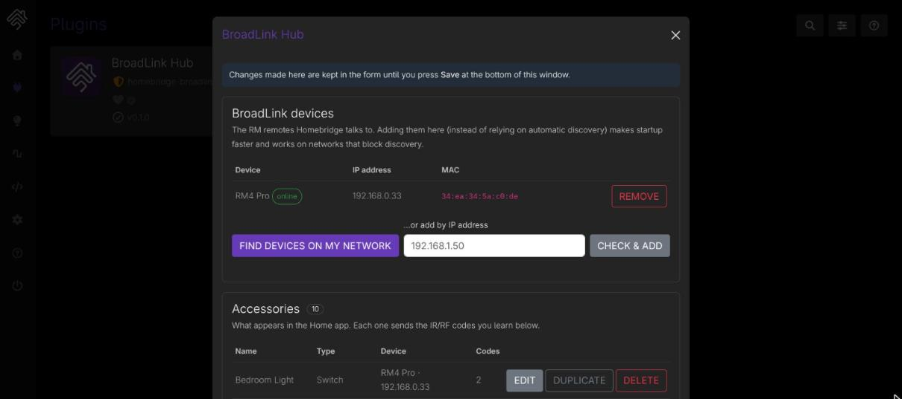

# BroadLink Hub for Homebridge

Control your TV, air conditioner, fans, lights, blinds, garage door and anything else that has an infrared (IR) or radio (RF) remote, from the Apple **Home** app and **Siri**, through a BroadLink RM remote (RM mini 3, RM Pro, RM4 mini, RM4 Pro and relatives).



## Pick your path

<div class="persona-grid">
<div class="persona">

### <span class="badge user">everyone</span> I just want it working

Install, find your BroadLink, add your devices and teach them your remote's buttons. No JSON editing.

[Start here →](guide/requirements.md)

</div>
<div class="persona">

### <span class="badge adv">advanced</span> I want every option

All platform, connection and accessory options with defaults, code sequences, several BroadLinks, MQTT sensors.

[Configuration →](advanced/config.md)

</div>
<div class="persona">

### <span class="badge dev">developer</span> I want to build on it

How the plugin is put together, the BroadLink wire protocol, the standalone client library and the test rigs.

[Architecture →](developer/architecture.md)

</div>
</div>

## What makes it different

| | |
| --- | --- |
| **Set up in the Homebridge UI** | Find devices, add accessories and learn each code by pressing the button on your remote, with on-screen guidance. Paste codes from Home Assistant / SmartIR (base64) or Pronto. |
| **Fast** | A tap in the Home app reaches the BroadLink in about 2 ms of plugin time. Commands wait for the device's acknowledgement, with a timeout that learns your network's round trip. |
| **Reliable** | If the BroadLink reboots, the plugin logs back in before your next tap. Codes are never blindly re-sent, so power toggles don't flip twice. |
| **Finds devices on tricky Wi-Fi** | When the network drops discovery broadcasts, it asks every address on your subnet directly. |
| **Drop-in successor** | Same config as [homebridge-broadlink-rm](https://github.com/kiwi-cam/homebridge-broadlink-rm), same accessories in the Home app (rooms, scenes and automations stay), same saved state. |
| **Local only** | No BroadLink cloud account. Two runtime dependencies. Homebridge 1.8+ and 2.x, Node 20–26. |

## How it works, in one picture

```
 Home app / Siri ──HomeKit──▶ Homebridge ──▶ BroadLink Hub ──UDP (LAN)──▶ BroadLink RM ──IR / RF──▶ TV, AC, fan…
                                                 ▲
                         settings page ──────────┘  (find devices, learn & test codes)
```

The BroadLink RM is a "universal remote" on your Wi-Fi. It can **record** the signal a remote control sends (learning) and **replay** it on demand. BroadLink Hub stores those recordings ("codes") in your Homebridge config and replays the right one when you tap something in the Home app.

?> Everything stays on your local network. The plugin talks to the BroadLink directly; the BroadLink cloud and app are only needed once, to put the device on your Wi-Fi.
