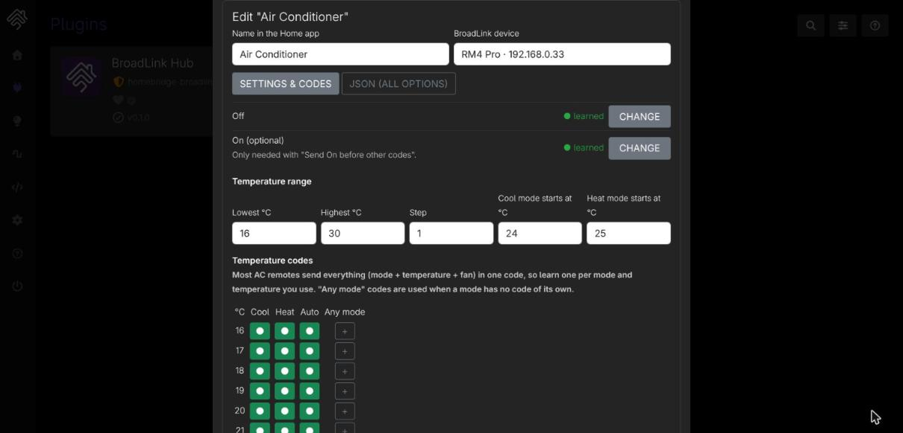
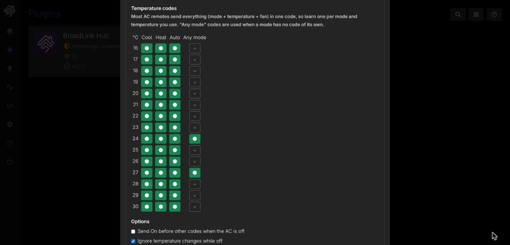

# Air conditioner <span class="badge adv">advanced</span>

`"type": "air-conditioner"`. A thermostat tile: **Off / Heat / Cool / Auto**, a target temperature and the current temperature (and humidity).



## How AC remotes work

An AC remote doesn't send "warmer" or "colder". Every press sends the **whole state** (mode, temperature, fan, swing) in one code. So you learn one code per state you want to use, typically one per mode and temperature:



To learn *Cool 24 °C*: set the remote to Cool, 24 °C and your preferred fan speed, then press its power or temperature button while the plugin is learning.

## Codes

| Key | Description |
| --- | --- |
| `off` | **Required.** Turns the AC off. |
| `coolNN`, `heatNN`, `autoNN` | Mode + temperature, for example `cool24`, `heat21`, `auto23`. Tried first. |
| `temperatureNN` | Temperature for any mode, for example `temperature24`. Used when there's no mode-specific code. |
| `cool`, `heat`, `auto` | A separate "mode" code, sent before the temperature code when the mode changes (only for ACs whose remote has separate mode buttons). The temperature code follows 250 ms later. |
| `on` | Sent before other codes when the AC is off, if `turnOnWhenOff` is set. |
| `offDryMode` | Sent instead of `off` when the AC was cooling (for ACs with a "dry before off" button). |

Each temperature code can be a string, or an object that also says which mode it represents:

```json
"temperature26": { "data": "2600…", "pseudo-mode": "heat" }
```

`pseudo-mode` (`heat`, `cool` or `auto`) makes the Home app show that mode when the code is used, for remotes that encode the mode in the temperature code.

### Which code is sent

When you choose a mode and temperature (say Cool 24 °C), the plugin looks for:

1. `cool24`
2. `temperature24`
3. the code for the mode's default temperature: `temperature<defaultCoolTemperature>` (or `defaultHeatTemperature` when the temperature is at or above `heatTemperature`)

If none exists, the log shows a `[CONFIG ERROR]` naming the missing key.

## Options

| Option | Default | Description |
| --- | --- | --- |
| `minTemperature` | `-15` | Lowest settable temperature. |
| `maxTemperature` | `50` | Highest settable temperature. |
| `tempStepSize` | `1` | Step of the temperature control (for example `0.5`). |
| `units` | `c` | Display units in the Home app: `c` or `f`. Codes are always keyed in the remote's units. |
| `defaultCoolTemperature` | `16` | Temperature used when switching to Cool, and the fallback cool code. |
| `defaultHeatTemperature` | `30` | Temperature used when switching to Heat, and the fallback heat code. |
| `heatTemperature` | `22` | For mode-less fallbacks: temperatures at or above this count as heating. |
| `replaceAutoMode` | — | Use `cool` or `heat` instead of Auto (for example when Siri turns the AC on in Auto). |
| `heatOnly`, `coolOnly` | `false` | Offer only one mode in the Home app. |
| `turnOnWhenOff` | `false` | Send `on` first when the AC is off (alias `sendOnWhenOff`). |
| `ignoreTemperatureWhenOff` | `false` | Changing the temperature while off doesn't send anything (and doesn't turn the AC on). |
| `preventResendHex` | `false` | Don't resend a code for the state the AC is already in (alias for `allowResend: false`). |
| `enableAutoOff`, `onDuration` | `false`, `60` | Turn the AC off automatically after `onDuration` seconds. |
| `autoHeatTemperature` | — | Turn on in Heat when the room drops below this. |
| `autoCoolTemperature` | — | Turn on in Cool when the room rises above this. |
| `minimumAutoOnOffDuration` | `120` | Minimum seconds between automatic on/off decisions (alias `autoMinimumDuration`). |
| `autoSwitchName` | — | Name of a [switch](accessories/switch.md) accessory that enables the automatic heat/cool (alias `autoSwitch`). |
| `noHumidity` | `false` | Hide humidity. |
| `noHistory` | `false` | Don't record Eve history. |
| `sendTemperatureOnlyWhenOff` | — | Accepted for compatibility; currently has no effect. |

Temperature sources (`pseudoDeviceTemperature`, `temperatureFilePath`, `w1DeviceID`, MQTT, `temperatureAdjustment`, `temperatureUpdateFrequency`, `tempSourceUnits`…) are described in [Sensors & MQTT](advanced/sensors.md).

## Example

```json
{
  "name": "Air Conditioner", "type": "air-conditioner",
  "minTemperature": 16, "maxTemperature": 30, "tempStepSize": 1,
  "defaultCoolTemperature": 24, "defaultHeatTemperature": 25,
  "ignoreTemperatureWhenOff": true, "preventResendHex": true,
  "data": {
    "off": "2600…",
    "cool23": "2600…", "cool24": "2600…", "cool25": "2600…",
    "heat24": "2600…", "heat25": "2600…",
    "temperature24": { "data": "2600…", "pseudo-mode": "cool" }
  }
}
```

?> You don't need every temperature. Learn the few you actually use, set `minTemperature` / `maxTemperature` around them, and let the fallbacks cover the rest.
