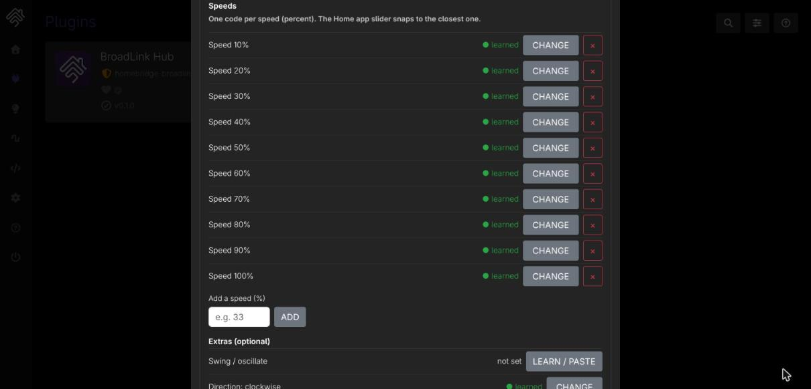

# Fan <span class="badge adv">advanced</span>

`"type": "fan"`. A fan tile with power, a speed slider and optional swing (oscillation) and direction.



## Codes

| Key | Description |
| --- | --- |
| `on` | Power on. |
| `off` | Power off. |
| `fanSpeedNN` | One code per speed in percent: `fanSpeed33`, `fanSpeed66`, `fanSpeed100` … The slider sends the closest one. |
| `fanSpeed` | With `speedCycle`: the single "speed" button that steps through the levels. |
| `swingToggle` | Sent when swing is switched on or off. |
| `clockwise`, `counterClockwise` | Sent when the rotation direction changes. |

## Options

| Option | Default | Description |
| --- | --- | --- |
| `hideSwingMode` | `false` | Hide the swing control. (`showSwingMode: false` does the same.) |
| `hideRotationDirection` | `false` | Hide the direction control. (`showRotationDirection: false` does the same.) |
| `stepSize` | `1` | Granularity of the speed slider in percent (1–100). |
| `speedSteps` | — | Number of speed levels. Sets `stepSize` to 100 / `speedSteps`, so the slider has exactly that many positions. |
| `speedCycle` | `false` | For fans whose remote has one "speed" button that cycles through the levels: the plugin sends the `fanSpeed` code as many times as needed to reach the chosen level, wrapping around after the highest (needs `speedSteps`). |
| `defaultSpeedStep` | — | Speed level (in `speedSteps`) to use when turned on. |
| `defaultFanSpeed` | `100` | Speed (percent) to restore with `alwaysResetToDefaults`. |
| `alwaysResetToDefaults` | `false` | Reset the speed to the default each time the fan turns off. |
| auto on/off, ping | | Same as [switch](accessories/switch.md?id=options). |

## Example

```json
{
  "name": "Ceiling Fan", "type": "fan", "hideRotationDirection": true,
  "data": {
    "on": "b1c0…", "off": "b1c0…", "swingToggle": "b1c0…",
    "fanSpeed33": "b1c0…", "fanSpeed66": "b1c0…", "fanSpeed100": "b1c0…"
  }
}
```

## fanv1

`"type": "fanv1"` uses HomeKit's older fan service (no swing). Same codes and options otherwise. Use it only if a home hub or app needs the old service.
