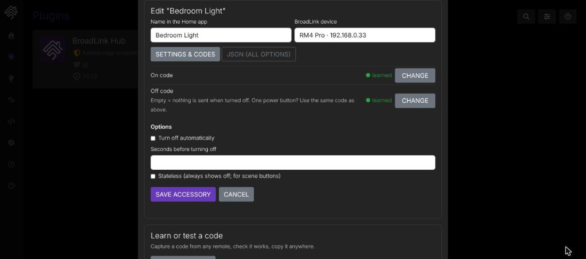

# Switch <span class="badge adv">advanced</span>

`"type": "switch"`. The most flexible accessory: one tile that sends one code when turned on and (optionally) another when turned off. Use it for lamps, LED strips, projector screens, or "scene buttons" like *AC turbo*.



## Codes

| Key | Description |
| --- | --- |
| `on` | Sent when the switch turns on. |
| `off` | Sent when it turns off. Without `off`, turning off sends nothing (right for scene buttons and auto-off boosts). For a device with one power button that toggles, put the same code in `on` and `off`. |

`data` can also be a single code string: it's sent when turned on.

## Options

| Option | Default | Description |
| --- | --- | --- |
| `enableAutoOff` | `false` | Turn the switch off automatically after `onDuration`. |
| `onDuration` | `60` | Seconds before the automatic off. |
| `enableAutoOn` | `false` | Turn the switch back on automatically after `offDuration`. |
| `offDuration` | `60` | Seconds before the automatic on. |
| `stateless` | `false` | Send the on code, then immediately show off again. Ideal for buttons that do something rather than switch something. |
| `disableAutomaticOff`, `disableAutomaticOn` | — | *Alias*, inverted: `disableAutomaticOff: false` = `enableAutoOff: true`. |
| ping options | | Follow the real device state: see [State from ping](advanced/ping.md). |

## Examples

A lamp with separate on/off codes:

```json
{ "name": "Bedroom Light", "type": "switch", "data": { "on": "2600…", "off": "2600…" } }
```

A "boost" button that turns itself off after 5 minutes:

```json
{ "name": "AC Turbo", "type": "switch", "enableAutoOff": true, "onDuration": 300, "data": "2600…turbo…" }
```

A stateless "brighter" button to put in scenes:

```json
{ "name": "Light Brighter", "type": "switch", "stateless": true, "data": "2600…brighter…" }
```

A TV-on macro (power, wait, input):

```json
{ "name": "Movie Mode", "type": "switch", "stateless": true,
  "data": { "on": [ { "data": "2600…power…", "pause": 3 }, { "data": "2600…hdmi1…" } ] } }
```
