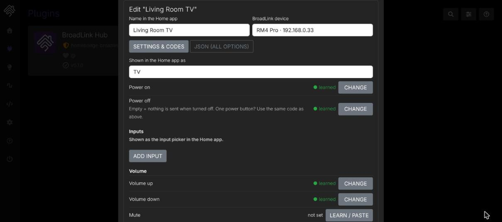
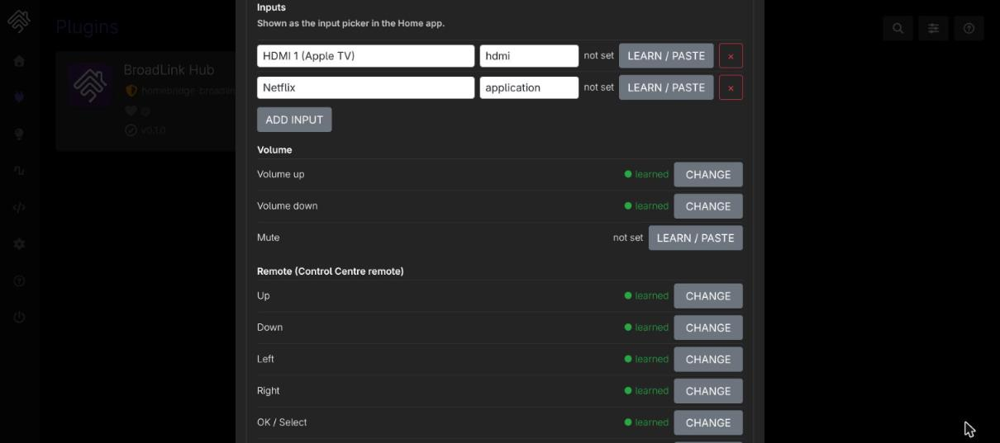
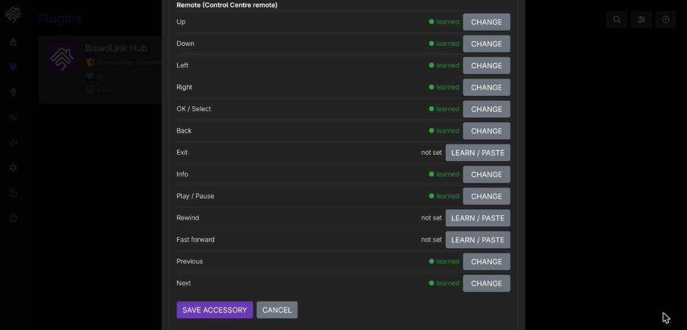

# TV / receiver <span class="badge adv">advanced</span>

`"type": "tv"`. A Television accessory: power, an input picker, volume via the iPhone buttons, and the **Apple TV Remote** in Control Centre. Also for set-top boxes, soundbars and AV receivers.



!> HomeKit requires TVs to be **separate accessories**. After a restart, add each one in the Home app: **+ → Add Accessory → More options…**, pick it and enter your Homebridge code.

## Codes

| Key | Description |
| --- | --- |
| `on`, `off` | Power on / off. Without `off`, turning the TV off sends nothing; if the TV has one power button that toggles, put the same code in both. |
| `inputs` | A list of `{ "name", "type", "data" }`: the input picker. `type` is one of `hdmi`, `tuner`, `application`, `airplay`, `usb`, `composite_video`, `component_video`, `s_video`, `dvi`, `home_screen`, `other`. |
| `volume` | `{ "up", "down", "mute" }`. Sent by the iPhone volume buttons while the remote is open. |
| `remote` | Remote keys: `arrowUp`, `arrowDown`, `arrowLeft`, `arrowRight`, `select`, `back`, `exit`, `info`, `playPause`, `rewind`, `fastForward`, `previousTrack`, `nextTrack`. |
| `powerMode` | `{ "show", "hide" }`: codes for the *View TV Settings* menu in the Home app (optional). |





## Options

| Option | Default | Description |
| --- | --- | --- |
| `subType` | `tv` | Icon and category: `tv`, `stb` (set-top box), `receiver` (audio receiver / soundbar), `stick` (streaming stick). |
| auto on/off, ping | | Same as [switch](accessories/switch.md?id=options). Ping is very useful for smart TVs. |

## Example

```json
{
  "name": "Living Room TV", "type": "tv", "subType": "tv",
  "pingIPAddress": "192.168.1.80", "pingIPAddressStateOnly": true,
  "data": {
    "on": "2600…", "off": "2600…",
    "inputs": [
      { "name": "Apple TV", "type": "hdmi", "data": "2600…hdmi1…" },
      { "name": "Netflix", "type": "application", "data": "2600…netflix…" }
    ],
    "volume": { "up": "2600…", "down": "2600…", "mute": "2600…" },
    "remote": { "arrowUp": "2600…", "arrowDown": "2600…", "arrowLeft": "2600…", "arrowRight": "2600…",
                "select": "2600…", "back": "2600…", "playPause": "2600…", "info": "2600…" }
  }
}
```

?> A soundbar as `"subType": "receiver"` gets its volume buttons in the Control Centre remote too.
