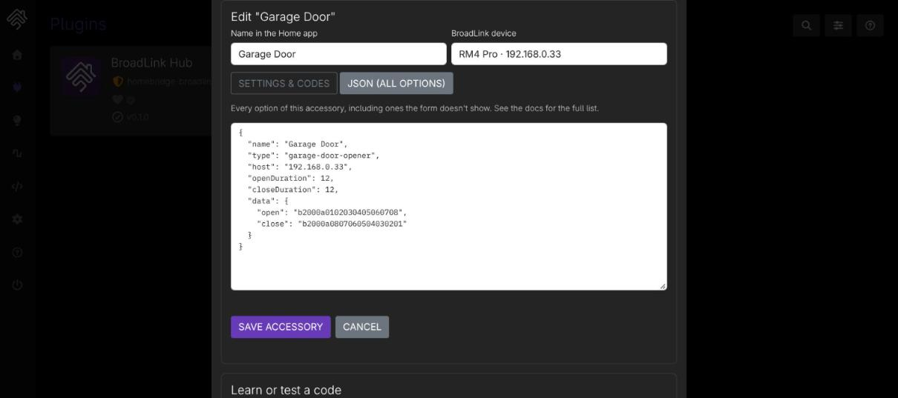

# How the config is organised <span class="badge adv">advanced</span>

The settings page writes an ordinary Homebridge config block. You can also edit it directly: **Homebridge UI → ⋮ (plugin card) → JSON Config**, or `config.json` itself. Both ways work together; the settings page keeps any option it doesn't show.

The quickest way to edit one accessory's options is its **JSON** tab on the settings page, which shows every option of that accessory, including ones without a form field:



## Structure

```json
{
  "platforms": [
    {
      "platform": "BroadlinkRM",
      "name": "BroadLink Hub",
      "hosts": [
        { "address": "192.168.1.50", "mac": "34:ea:34:12:ab:cd", "isRM4": true, "isRFSupported": true }
      ],
      "hideLearnButton": true,
      "hideScanFrequencyButton": true,
      "accessories": [
        {
          "name": "Bedroom Light",
          "type": "switch",
          "host": "192.168.1.50",
          "data": { "on": "2600500000012694…", "off": "2600580000012595…" }
        },
        {
          "name": "Living Room TV",
          "type": "tv",
          "data": {
            "on": "2600…",
            "off": "2600…",
            "inputs": [ { "name": "HDMI 1", "type": "hdmi", "data": "2600…" } ],
            "volume": { "up": "2600…", "down": "2600…", "mute": "2600…" },
            "remote": { "arrowUp": "2600…", "select": "2600…" }
          }
        }
      ]
    }
  ]
}
```

- **Platform level**: `platform` (must be `BroadlinkRM`), `name`, the BroadLink devices (`hosts`) and plugin-wide settings. See [Platform & connection options](advanced/platform.md).
- **`accessories`**: one entry per tile in the Home app. Every entry has `name`, `type` and usually `data` (the codes), plus [options every accessory has](advanced/common-options.md) and type-specific options in the [accessory reference](accessories/README.md).
- **Codes** are strings of hex, or richer structures for repeats and sequences: see [Codes](advanced/codes.md).

## Rules worth knowing

| Rule | Why |
| --- | --- |
| `"platform"` must stay `BroadlinkRM`. | Homebridge builds accessory IDs from it. Changing it creates new accessories in the Home app. |
| Accessory `name`s must be unique. | The name is part of the accessory's ID. Renaming = a new accessory for HomeKit. |
| Numbers and booleans without quotes: `"onDuration": 5`, `"enableAutoOff": true`. | Quoted values (`"5"`, `"true"`) stop Homebridge at startup with a `[CONFIG ERROR]` line naming the key. |
| `host` can be an IP address or a MAC (`34:ea:34:12:ab:cd`, `34ea3412abcd` or with `-`). | MACs survive IP changes when you use automatic discovery. |
| `"disabled": true` keeps an accessory in the config but out of the Home app. | Handy while experimenting. |

## Validating your JSON

A stray comma stops Homebridge from starting. The Homebridge UI's JSON editor highlights syntax errors. On the command line:

```bash
python3 -m json.tool /var/lib/homebridge/config.json > /dev/null && echo OK
```

## Example configs

The repository has two complete examples: [config-sample.json](https://github.com/pirates-killer/homebridge-broadlink-hub/blob/main/examples/config-sample.json) (every accessory type) and [config-multiple-rm-devices.json](https://github.com/pirates-killer/homebridge-broadlink-hub/blob/main/examples/config-multiple-rm-devices.json).
