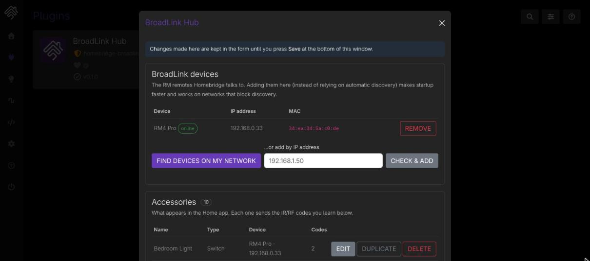
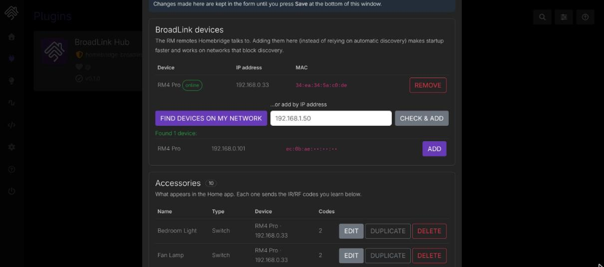
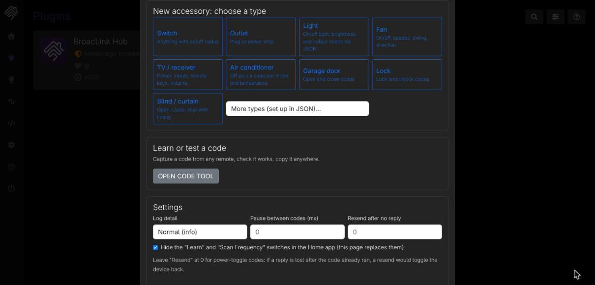
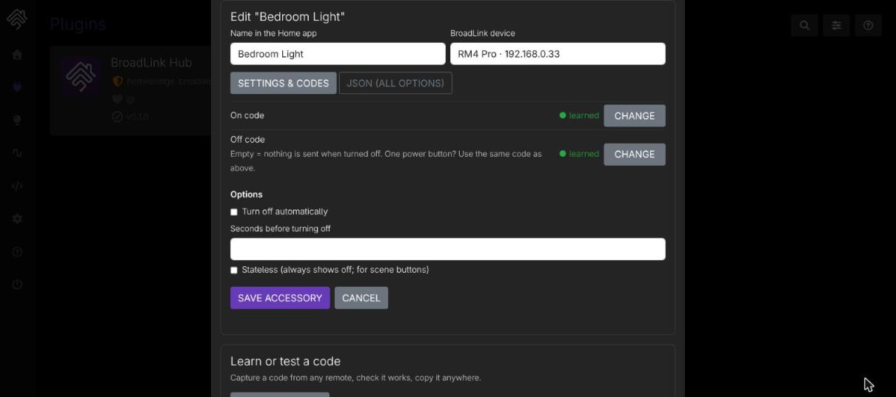
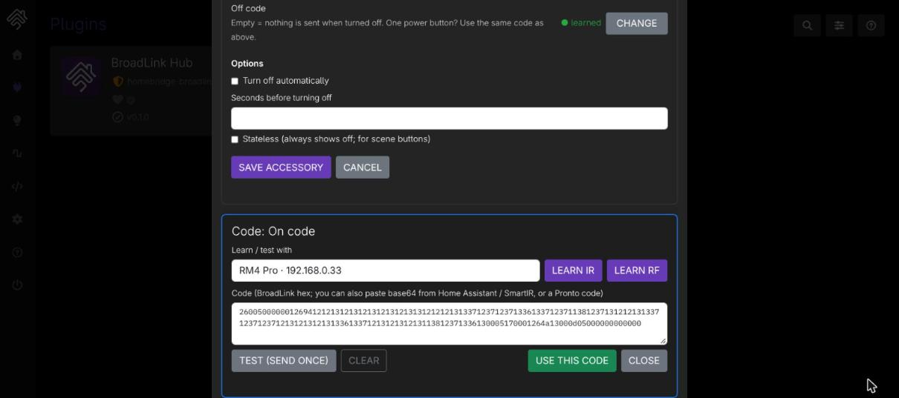
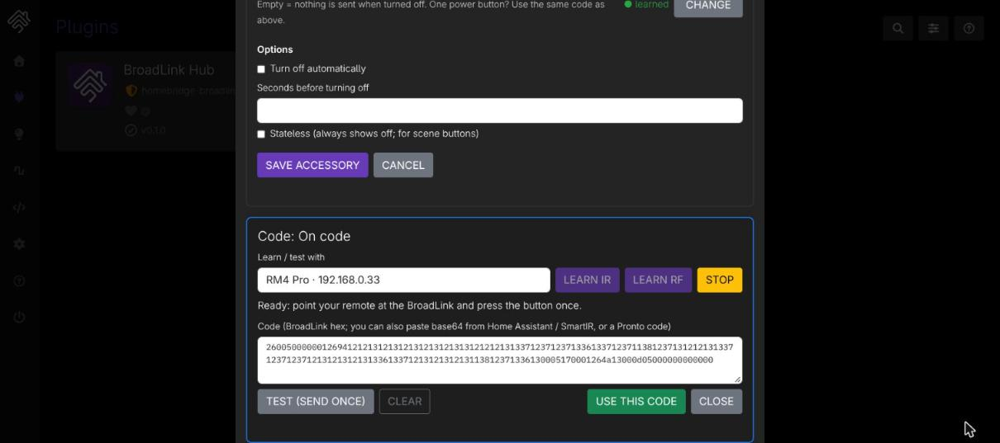
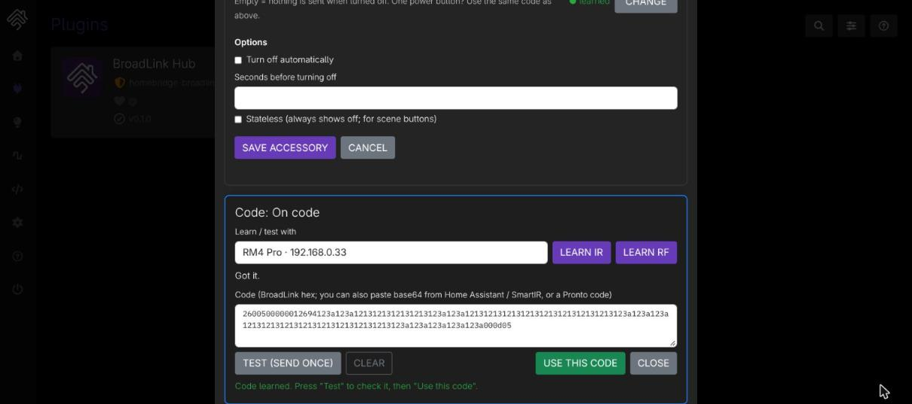
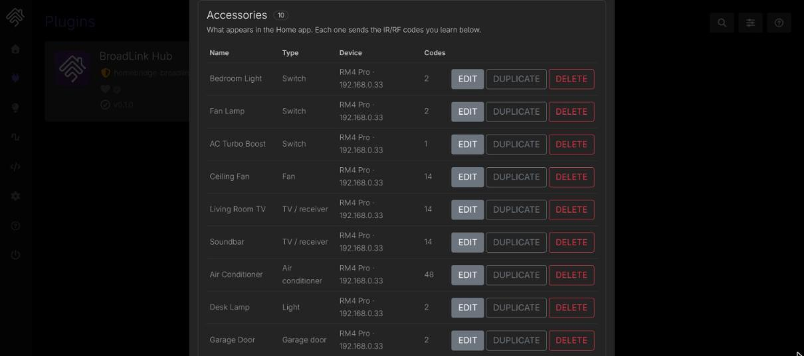
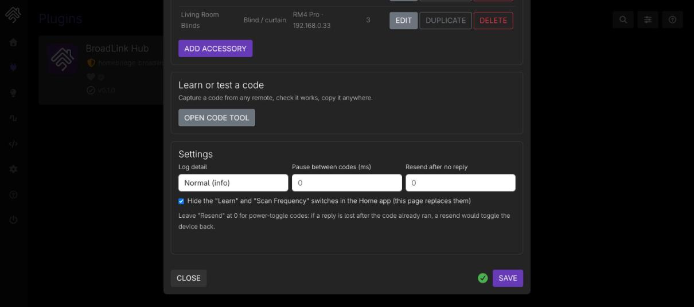
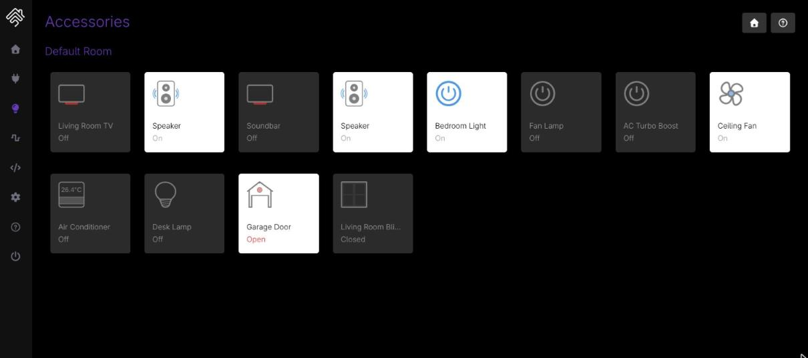

# First setup, step by step everyone

Everything here happens on the plugin's settings page: **Plugins → BroadLink Hub → ⋮ → Plugin Config**.

?> Changes on this page are kept in the form until you press **Save** at the bottom of the window. Homebridge applies them after a restart.

## 1. Add your BroadLink

Click **Find devices on my network**. In about three seconds every BroadLink that answers is listed with its model, IP address and MAC address. Click **Add** next to your RM.

(MAC address partly hidden in this screenshot.)

If nothing shows up:

- Type the BroadLink's IP address into **…or add by IP address** and click **Check & add**.
- Make sure the device is [unlocked](guide/requirements.md?id=unlock-the-device).
- Make sure Homebridge and the BroadLink are on the same network.

Each device in the list shows a live status badge:

| Badge | Meaning |
| --- | --- |
| **online** | The BroadLink answered just now. |
| **locked in BroadLink app** | It answers but refuses control. [Unlock it](guide/requirements.md?id=unlock-the-device). |
| **not answering** | Wrong IP address, powered off, or on another network. |

?> **Why add devices at all?** Without any devices listed, the plugin searches the network every time Homebridge starts. Listing them makes startup faster and works on networks that block discovery. You can add several BroadLinks; each accessory chooses which one to use.

## 2. Add an accessory

Click **Add accessory** and choose what the Home app should show.

| Type | Use it for |
| --- | --- |
| **Switch** | Anything with on/off buttons: lamps, LED strips, a projector screen, a "scene" button. |
| **Outlet** | The same, shown as a plug/socket. |
| **Light** | A light bulb tile; optionally brightness and colour codes. |
| **Fan** | Ceiling or desk fans, with speeds, swing and direction. |
| **TV / receiver** | TVs, set-top boxes, soundbars, AV receivers: power, inputs, volume and the iPhone remote. |
| **Air conditioner** | Split / window ACs: off, modes and a code per temperature. |
| **Garage door**, **Lock**, **Blind / curtain** | Open/close (or lock/unlock) style devices, with timing. |
| **More types** | Heater-cooler, air purifier, humidifier, sensors and the older multi-code switches. These are set up in the JSON tab. See the [accessory reference](accessories/README.md). |

Give it a **name** (this is what the Home app and Siri use) and choose which **BroadLink device** sends its codes.

!> Names must be unique. **Renaming** an accessory later makes the Home app treat it as a new accessory, so its room, scenes and automations would need setting up again. The page warns you before you rename.

## 3. Teach it your remote's buttons

Every code has a **Learn / paste** button (or **Change**, once learned). It opens the code panel:

1. Click **Learn IR** (or **Learn RF** for radio remotes on Pro models).
2. Point your remote at the BroadLink, from about 10–30 cm, and press the button **once**.

   

3. When it says **Got it**, the code appears in the box.

   

4. Click **Test (send once)**. Your device should react, exactly as if you had pressed the remote.

   

5. Click **Use this code**. The row now shows **● learned**.

Repeat for each button the accessory needs. [Learning codes](guide/learning-codes.md) has tips, the RF procedure, and how to paste codes from elsewhere.

## 4. Save

Click **Save accessory** in the editor. The accessory list shows every accessory with its type, device and number of learned codes, and **Edit**, **Duplicate** (handy for similar devices) and **Delete** (click twice to confirm):

Then click **Save** at the bottom of the window. Homebridge asks to restart: do it.

## 5. Add it to the Home app

If this is your first Homebridge plugin, add the Homebridge bridge in the Home app: **+ → Add Accessory** and scan the QR code from the Homebridge UI **Status** page (or enter the code under it).

Your new accessories appear in the Home app right away. They're also on the Homebridge UI's **Accessories** page, where you can try them from the browser:

**TVs and receivers** are separate accessories (an Apple rule for TVs): in the Home app tap **+ → Add Accessory → More options…**, choose the TV and enter the same code.

?> **iPhone doesn't find the bridge?** Pairing uses Bonjour (mDNS). Make sure the phone is on the same network segment as Homebridge. Some mesh or guest Wi-Fi networks don't pass it; join the main network or the one Homebridge is wired to.

## What next

- [Using it in the Home app](guide/home-app.md): AC modes, fan speeds, the TV remote, scenes and Siri.
- [Settings](guide/home-app.md?id=settings-on-the-plugin-page): log detail, the pause between codes, and resends.
