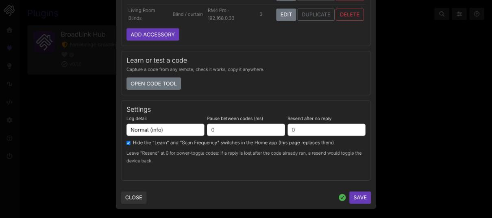

# Using it in the Home app everyone

## How state works with IR and RF

Infrared and radio remotes only **send**; the device never reports back. So the Home app shows what BroadLink Hub **last sent**, not what the device is really doing. If someone uses the original remote, the Home app doesn't know.

What helps:

- **Separate on and off codes** where your remote or a database has them. Pressing "off" twice is harmless; pressing a toggle twice turns it back on.
- **Ping / ARP detection** for networked devices (smart TVs, receivers): the plugin can watch whether the device is on the network and update the tile. See [State from ping](advanced/ping.md).
- **Stateless switches** for "scene" buttons such as *AC turbo* or *Light: brighter*: the tile springs back to off after sending.

## Switches, outlets and lights

Tap to send the on or off code. With **Turn off automatically** the tile switches itself off after the set time; that's useful for things like a "boost" button. Light tiles always have a brightness slider; it sends the closest learned brightness code (if you learned any, see [Light](accessories/light.md)). A colour picker appears when you have learned colour (hue) codes.

## Fans

The fan tile has **power**, a **speed** slider and optionally **swing** and **direction**. The slider snaps to the closest speed you have a code for: with codes for 33 %, 66 % and 100 %, choosing 50 % sends the 66 % code.

## TVs, set-top boxes and receivers

- **Power** and the **input picker** are on the TV tile.
- The **remote** is in Control Centre: add **Apple TV Remote** to Control Centre, open it and pick your TV at the top. Arrows, select, back, play/pause and info send the codes you learned under *Remote*. The iPhone volume buttons send *Volume up/down* while the remote is open.
- Soundbars and receivers can be shown as *Audio receiver*, and set-top boxes as *Set-top box*. The tile icon changes, everything else is the same.

## Air conditioners

The AC tile offers **Off / Heat / Cool / Auto** and a target temperature. Each change sends the code you learned for that mode and temperature (for example *Cool 24 °C*).

- Switching to a mode starts at the **mode's start temperature** (*Cool mode starts at*, *Heat mode starts at*) and sends that code.
- The **current temperature** comes from the BroadLink's own sensor where it has one (RM4 Pro, RM4 mini with the sensor cable), or from another source ([sensors](advanced/sensors.md)). Without a source it shows the last known value.
- The Home app shows the AC as off while it's off. If someone uses the original remote, tap the mode again to bring the Home app back in sync.

## Garage doors, locks and blinds

These show **opening → open** and **closing → closed**. The plugin can't know the real position, so it uses the durations you set (*seconds to open*, *seconds to close*). Blinds set to 50 % run for half the time and then send **Stop**.

## Scenes, automations and Siri

Everything works like native HomeKit accessories: put them in scenes ("Good night" turns off TV, soundbar and lights), automations ("When I leave, turn off the AC") and use Siri ("Set the air conditioner to 22 degrees").

When a scene triggers several codes at once, BroadLink Hub sends them **one after another, in order**, waiting for each acknowledgement. That avoids the dropped codes you get when IR signals overlap. If one device still misses codes in quick succession, raise **Pause between codes** in the settings.

## Settings on the plugin page

| Setting | What it does |
| --- | --- |
| **Log detail** | How much the plugin writes to the Homebridge log. *Debug* shows every packet and round-trip time, which helps with troubleshooting. |
| **Pause between codes (ms)** | Minimum gap between two codes sent through the same BroadLink. 0 is fine for most devices; try 100–300 if one misses codes in a scene. |
| **Resend after no reply** | Resend a code if the BroadLink doesn't acknowledge it. Keep **0** for power toggles: if the reply was lost after the code worked, a resend would toggle the device back. |
| **Hide the "Learn" switches** | Hides the two learning switches the plugin can add to the Home app. The settings page replaces them. |
