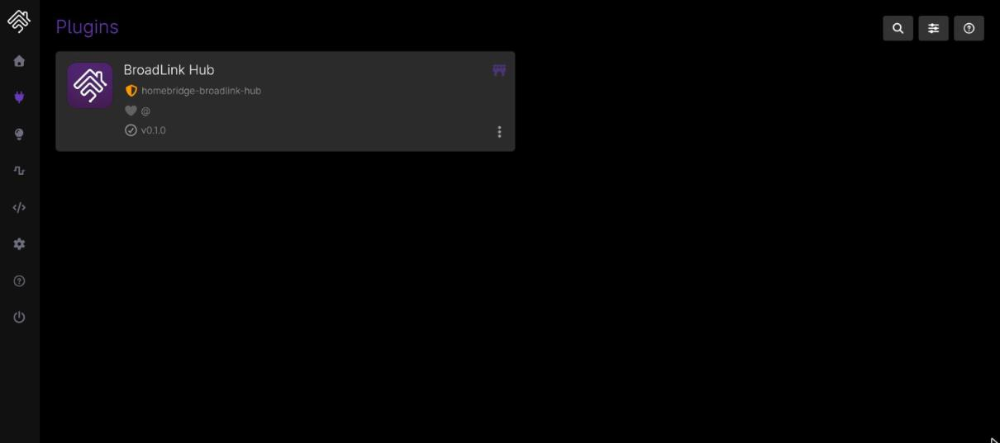
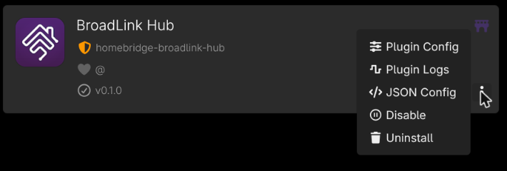

# Install <span class="badge user">everyone</span>

## With the Homebridge UI (recommended)

1. Open the Homebridge UI in your browser (usually `http://<your-homebridge>:8581`).
2. Go to **Plugins** and search for **BroadLink Hub**.
3. Click **Install** and wait for it to finish.
4. The plugin now appears under **Plugins**:

   

5. Open the plugin's settings: on its card, click **⋮ → Plugin Config**.

   

Continue with [First setup](guide/first-setup.md).

## From the command line

```bash
# Homebridge installed with hb-service (Raspberry Pi image, Debian/Ubuntu packages)
sudo hb-service add homebridge-broadlink-hub

# plain npm install
npm install -g homebridge-broadlink-hub
```

Then restart Homebridge.

## Run it as a child bridge (optional)

Homebridge can run a plugin in its own process ("child bridge"). If the plugin ever crashes or restarts, your other accessories are not affected, and it gets its own pairing in the Home app.

In the Homebridge UI: **Plugins → BroadLink Hub → ⋮ → Bridge Settings**, turn on **Enable Child Bridge**, save, restart Homebridge, then add the new bridge in the Home app with the code shown.

?> Coming from homebridge-broadlink-rm and already using a child bridge? Keep the same `_bridge` block in your config. The child bridge keeps its identity, so nothing needs re-pairing. See [Migrating](guide/migrating.md).

## Updating

Updates appear in the Homebridge UI like for any plugin. Read the [changelog](https://github.com/pirates-killer/homebridge-broadlink-hub/blob/main/CHANGELOG.md) for what changed. Your config and learned codes are kept.

## Uninstalling

**Plugins → BroadLink Hub → ⋮ → Uninstall**. The accessories disappear from the Home app after the restart. Your config block stays in `config.json` until you remove it, so reinstalling later restores everything.
