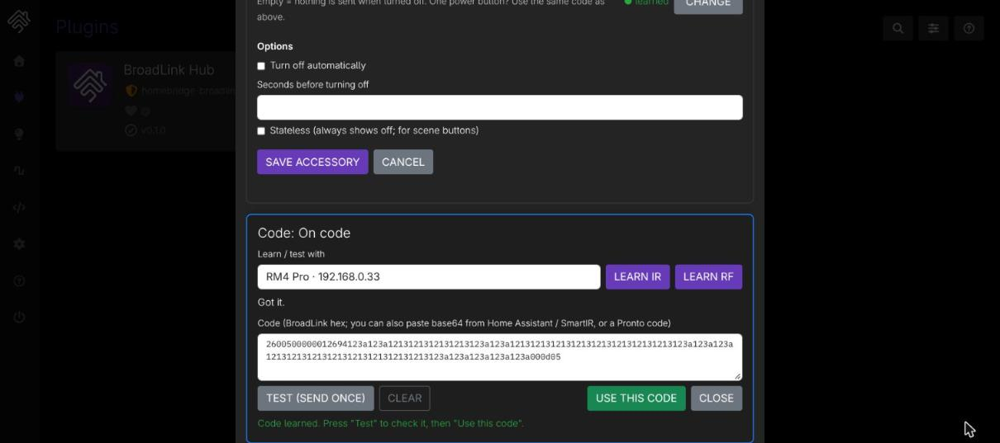
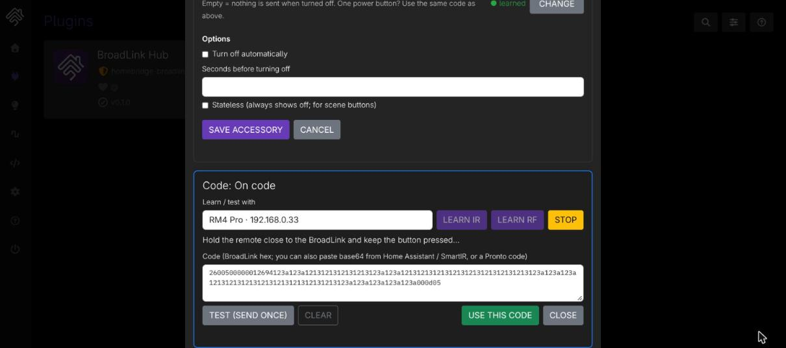
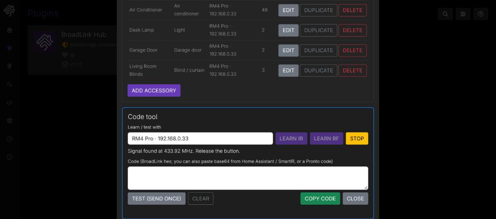
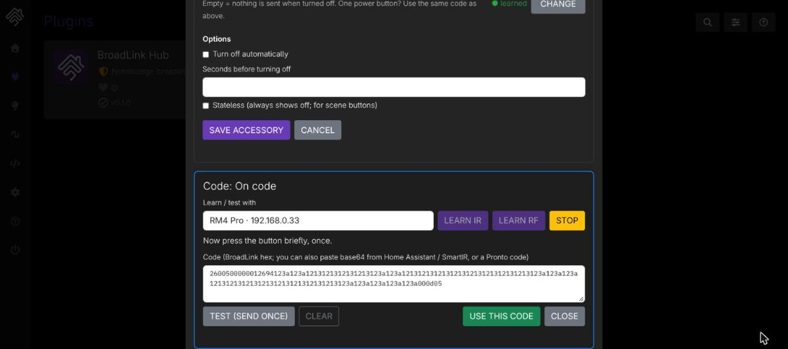
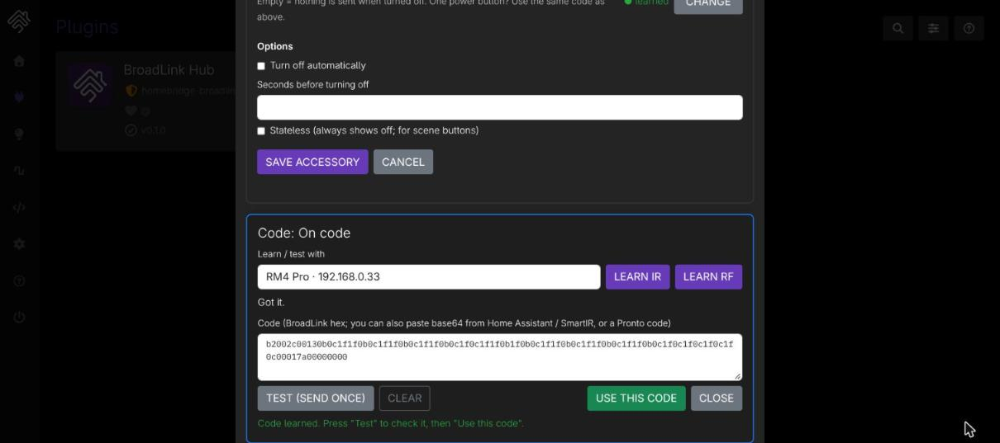
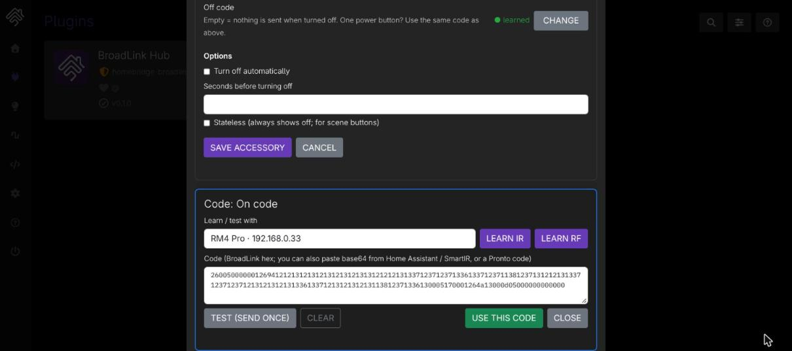

# Learning codes everyone

A **code** is a recording of what your remote sends when you press a button. BroadLink Hub stores codes as hexadecimal text (for example `2600500000012694…`) in your config, and the BroadLink replays them.

There are three ways to get codes:

1. **Learn** them with your own remote (best: exactly what your device expects).
2. **Paste** them from elsewhere: Home Assistant, SmartIR code files, Pronto databases, or an old homebridge-broadlink-rm config.
3. Use the **Learn switch** in the Home app (the old way, still available; see [Learn switches](accessories/learn-code.md)).

## Learning infrared (IR)

1. Open the code panel (**Learn / paste** next to a code, or **Open code tool**).
2. Pick the BroadLink under **Learn / test with**.
3. Click **Learn IR**. The page says **Ready: point your remote at the BroadLink and press the button once.**
4. Hold the remote 10–30 cm from the BroadLink, pointing at it, and press the button **briefly, once**.
5. **Got it.** The code appears. Click **Test (send once)** and check the device reacts, then **Use this code**.

If nothing is received within 30 seconds the page says **Nothing received**; just try again.

### Tips for good IR codes

- **One short press.** Holding the button can record a "repeat" signal that some devices ignore.
- **Close, not touching.** Very close range can overload the receiver; 10–30 cm works best.
- **Avoid bright sunlight** and fluorescent lamps near the BroadLink while learning.
- **Toggle vs. discrete codes.** Many TVs have one power button that toggles. If you can find separate "power on" and "power off" codes (some remotes have them, or databases do), the Home app always shows the right state.
- **AC remotes send their whole state.** An air-conditioner remote doesn't send "temperature up": it sends mode + temperature + fan in one code. So you learn one code per mode and temperature (see [Air conditioner](accessories/air-conditioner.md)). Set the remote to the mode and temperature you want, then press its power or temperature button while learning.

## Learning radio codes (RF)

Only Pro models (RM Pro, RM4 Pro, RM4C Pro) have the radio. RF learning has two steps: first the BroadLink finds the **frequency**, then it records the **code**.

1. Click **Learn RF**.
2. **Hold the remote close to the BroadLink and keep the button pressed…** Keep holding until the frequency is found (usually a few seconds).

   

3. **Signal found at 433.92 MHz. Release the button.**

   

4. **Now press the button briefly, once.**

   

5. **Got it.** RF codes start with `b2` (433 MHz) or `d7` (315 MHz).

   

!> **Rolling-code remotes can't be copied.** Many modern garage doors and car remotes change their code on every press for security. A recorded code won't open them. Fixed-code remotes (most blinds, fans, sockets and older gates) work fine.

?> If RF learning never finds a frequency, try holding the remote at different distances, and make sure the remote's battery is good. Some 315 MHz remotes are hard to detect; see [Troubleshooting](guide/troubleshooting.md?id=rf-learning-never-finds-a-frequency).

## Pasting codes from elsewhere

Paste into the code box and click **Use this code**. The format is detected and converted to BroadLink hex automatically.

| Source | Looks like | Notes |
| --- | --- | --- |
| BroadLink hex | `2600500000012694123a…` | What this plugin and homebridge-broadlink-rm use. Spaces and `0x` are removed for you. |
| Base64 (Home Assistant, SmartIR) | `JgBQAAABKJQSOhI6EhMS…` | Home Assistant's `remote.learn_command` output and the SmartIR JSON files use this. |
| Pronto hex | `0000 006C 0022 0002 015B 00AD …` | Found in many IR databases (for example irdb, remotecentral). Starts with `0000`. |

## The code tool

**Learn or test a code → Open code tool** opens the same panel without an accessory. Use it to capture a code and copy it somewhere else, or to check that a code from a database works before adding it.

## Testing safely

**Test (send once)** really sends the code: the device in the room reacts. It is sent once, never repeated. The result line shows how quickly the BroadLink acknowledged it (usually 10–30 ms on a home network).

If the BroadLink acknowledges but the device doesn't react, the code is wrong for that device (or out of the BroadLink's line of sight for IR). Learn it again.
