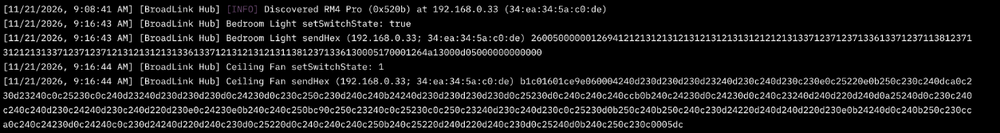

# Troubleshooting & FAQ everyone

## First: look at the log

Most problems explain themselves in the Homebridge log (**Logs** in the Homebridge UI, or the **Plugin Logs** entry in the plugin's ⋮ menu). A healthy start and two taps look like this:

For more detail set **Log detail → Debug** in the plugin settings, save and restart. Every packet is then logged with its round-trip time, for example `<- 0xee #4711 err=0 14.2 ms`.

## The BroadLink isn't found

| Symptom in the log / page | Cause and fix |
| --- | --- |
| *Find devices* finds nothing | Homebridge and the BroadLink are on different networks, or the device is off. Add it by IP address. |
| `… is locked. Turn off "Lock device" in the BroadLink app` | [Unlock the device](guide/requirements.md?id=unlock-the-device). |
| `… did not answer discovery; using configured flags` | The device didn't answer at the configured IP. Check the address, give it a DHCP reservation, and make sure no firewall blocks UDP port 80 to the BroadLink. |
| `Ignoring unknown Broadlink device type 0x….` | A BroadLink the plugin doesn't know. If it's an RM, add it by IP address and set *RM4 family* / *Has RF*. Please [open an issue](https://github.com/pirates-killer/homebridge-broadlink-hub/issues) with the type code. |
| `Broadlink RM device at … is not responding` | It stopped answering (power, Wi-Fi). The plugin keeps checking and logs `reachable again` when it's back; nothing to do. |

?> **Wi-Fi networks that block discovery.** Many mesh systems and access points drop the broadcast packets discovery uses. BroadLink Hub then asks every address on your subnet directly, which usually finds it. Adding the device by IP address always works.

## A code doesn't work

1. Open the accessory, open the code and click **Test**.
   - **"Sent (acknowledged …)" but nothing happens**: the code is wrong for this device, or (IR) the BroadLink can't see the device. Learn it again, closer to the BroadLink's line of sight to the device.
   - **"The BroadLink did not answer"**: a network problem, see above.
2. Some devices need a code sent **twice** or **held**. Use a [repeat](advanced/codes.md?id=repeat-a-code) (`sendCount`).
3. Toggle codes get out of sync when the original remote is used. Use separate on/off codes where possible.

## The device reacts twice / turns back off

Usually one of these:

- **Resend after no reply** is above 0, and the BroadLink's reply was lost after the code had already worked. Set it back to 0 for toggle codes.
- The accessory has **Resend after reload** (`resendDataAfterReload`) on and Homebridge just restarted.
- Two accessories (or two Homebridge instances) send the same code.

## Codes in a scene go missing

When several codes are sent in a row, some devices miss one. BroadLink Hub already sends them one at a time; raise **Pause between codes** to 100–300 ms.

## The air conditioner shows the wrong temperature

- **0 °C or a frozen value**: your BroadLink has no temperature sensor (RM mini, RM4 mini without the cable, RM Pro). Use another [temperature source](advanced/sensors.md), or set `pseudoDeviceTemperature`.
- **Slightly off**: correct it with `temperatureAdjustment` (for example `-1.5`).

## RF learning never finds a frequency

- Only Pro models have the radio.
- Hold the remote 5–10 cm from the BroadLink and keep the button pressed for the whole search.
- Some 315 MHz remotes are hard to detect. Try another remote button, or learn a code with the original app's RF learning and paste it.
- [Rolling-code](guide/learning-codes.md?id=learning-radio-codes-rf) remotes can't be copied at all.

## The Home app shows "No Response"

- Homebridge itself is unreachable (check the Homebridge UI status), or the accessory threw an error (check the log).
- For TVs: they are separate accessories. Remove and re-add only if the TV's own pairing broke.

## The iPhone can't pair the bridge or a TV

Pairing uses Bonjour (mDNS). Put the iPhone on the same network segment as Homebridge; guest networks and some mesh setups don't pass mDNS. If you use several Homebridge instances, make sure each has its own `username` and `port`.

## Where is my config file?

| Setup | Location |
| --- | --- |
| Homebridge Raspberry Pi image / hb-service on Linux | `/var/lib/homebridge/config.json` |
| macOS / Windows hb-service, plain install | `~/.homebridge/config.json` |
| Docker | the volume mapped to `/homebridge` |

The Homebridge UI shows the exact path on its **Status** page and lets you edit it under **⋮ → JSON Config**.

## FAQ

**Does it need the internet or the BroadLink cloud?** No. Only the BroadLink app's first-time Wi-Fi setup uses the cloud.

**Can two Homebridge instances use the same BroadLink?** Yes. The BroadLink hands every client the same session, so they don't disturb each other.

**How many accessories can one BroadLink handle?** As many as you like; codes are queued and sent one after another.

**Can I use codes from my old setup?** Yes, they are the same format. See [Migrating](guide/migrating.md).

**Can it use the BroadLink app's built-in code library?** No. That library lives in the BroadLink cloud. Learn the codes with your remote, or paste them from an open database (SmartIR, irdb) via the [code formats](guide/learning-codes.md?id=pasting-codes-from-elsewhere) the settings page understands.

**Does the Home app know if someone used the original remote?** No; IR and RF only send. See [How state works](guide/home-app.md?id=how-state-works-with-ir-and-rf) for what helps.
